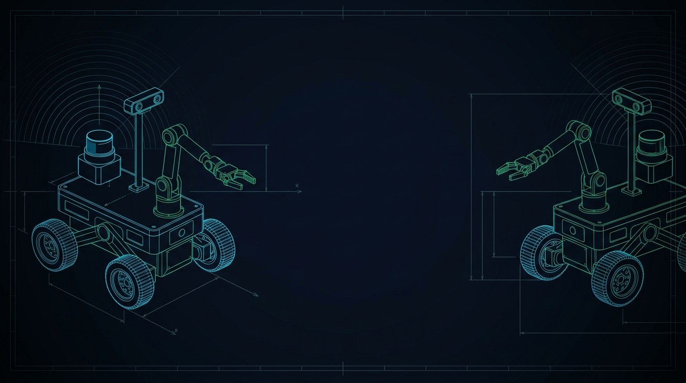
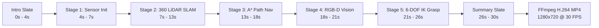

# VIKRAM-SLAM-Robotic Simulation-

A browser-based 3D robotics simulator and video renderer for a mobile manipulator robot. It runs a five-stage mission in an 8.0 x 6.0 m factory room and lets you export the full 30-second run as a 1280x720 MP4 video.

> Note: This is a software simulation running in the browser. It does not connect to physical robot hardware out of the box.

## Demo

- **Video Demo:** [Watch Studio Walkthrough & Simulation Video](https://screenapp.io/app/share/0bl7uPCgj9cpOwOySTuDyukf)
- **Exported Video Output:** `vikram_slam_complete_demo.mp4` (`1280x720`, `30 FPS`, `30.0 s` / `900` total frames — 4s intro, 22s simulation, 4s summary)
- **How to generate the demo video:** Click **Export MP4 Video** in the top bar. The app renders all 900 frames on the canvas, uploads them in batches to the Express server, and encodes an H.264 MP4 with FFmpeg for in-browser playback and download.



## Simulation Graph & Pipeline

### Telemetry Graph (Battery, SLAM Map Coverage & Motor Current)

This chart is plotted directly from the `Open Space` simulation timeline (`660` active frames across Stages 1 to 5):


### Video & Mission Pipeline



## What Happens in Each Stage

| Stage | Window | Frames | What the Robot Does |
| --- | --- | --- | --- |
| Intro | 0.0s – 4.0s | 120 | Shows the title screen and system pipeline over the robot schematic. |
| 1. Sensor Init | 4.0s – 7.0s | 90 | Spins up the 360-degree LiDAR and sweeps the room. |
| 2. LiDAR SLAM | 7.0s – 13.0s | 180 | Drives through the floor and fills the occupancy grid map (`Unknown`, `Free`, `Obstacles`). |
| 3. A\* Navigation | 13.0s – 18.0s | 150 | Computes an A\* path on the inflated costmap and parks at the pickup table. |
| 4. 3D Vision | 18.0s – 21.0s | 90 | Uses the onboard RGB-D feed to detect and lock onto the red cube's 3D coordinates. |
| 5. IK Grasp & Sort | 21.0s – 26.0s | 150 | Grabs the cube with the 6-DOF arm and drops it into the sorting bin. |
| Benchmark Outro | 26.0s – 30.0s | 120 | Summarizes map coverage, localization drift, and grasp status. |

## Features

- **Floor Presets & Grid Editor**: Switch between *Open Space*, *Corridor Maze*, and *Narrow Aisles*, or open the *Draw Grid* tab (`15 x 11` cells) to paint custom obstacles and move the drop-off bin before starting.
- **Camera Angles**: Auto-cycle between angles or lock the view to *Fixed*, *Follow*, or *First-Person*.
- **Studio Lighting**: Adjust light intensity (`0.30x` to `2.00x`) and color temperature (`2500 K` warm to `9000 K` cool) with quick mood presets.
- **Architectural Overlay**: Toggle a semi-transparent blueprint schematic and a projected `8.0 x 6.0 m` floor grid over the 3D scene to check obstacle placement.
- **Telemetry & Warnings**: Live battery drain gauge with low-battery warning below `25%`, motor current D3 chart, arm joint readouts, and a red proximity flash when front LiDAR drops below `0.50 m`.
- **Playback Speed**: Slow down (`0.20x`) or speed up (`2.50x`) simulation playback.
- **Voice Commands**: Click the microphone button to control playback, cameras, layouts, and speed using browser speech recognition (for example: *"Start simulation"*, *"Restart video"*, *"Set camera to follow mode"*).
- **MP4 Video Export**: Renders all 900 frames (`30 FPS`) and encodes `vikram_slam_complete_demo.mp4` on the backend with FFmpeg.

## Requirements

- **Node.js** (v18 or newer)
- **FFmpeg** available in your system `PATH` (needed for MP4 video export)

## Running Locally

```bash
npm install
npm run dev
```

Open `http://localhost:3000` in Chrome or Edge (Web Speech API is needed if you want to use voice commands).

### Other Scripts

- `npm run lint` — Type-check with `tsc --noEmit`
- `npm run build` — Build the production frontend bundle
- `npm start` — Run the production Express server on port `3000`

## Tech Stack

- **Frontend & UI**: React 19, TypeScript, Vite 8, Tailwind CSS 4, Lucide React
- **3D & Visualization**: Three.js (`WebGL2`), D3.js 7, HTML5 Canvas 2D (compositor & grid editor)
- **Simulation Logic**: TypeScript 2D LiDAR raycasting, Log-Odds SLAM occupancy grid, inflated A\* planner, differential-drive kinematics, and 6-DOF IK solver
- **Voice Input**: Browser Web Speech API (`SpeechRecognition` / `webkitSpeechRecognition`)
- **Backend & Export**: Node.js, Express 4 (`tsx` in dev), FFmpeg (`libx264` MP4 encoding)

